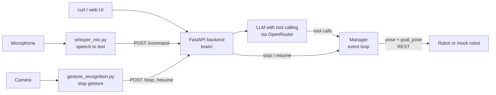
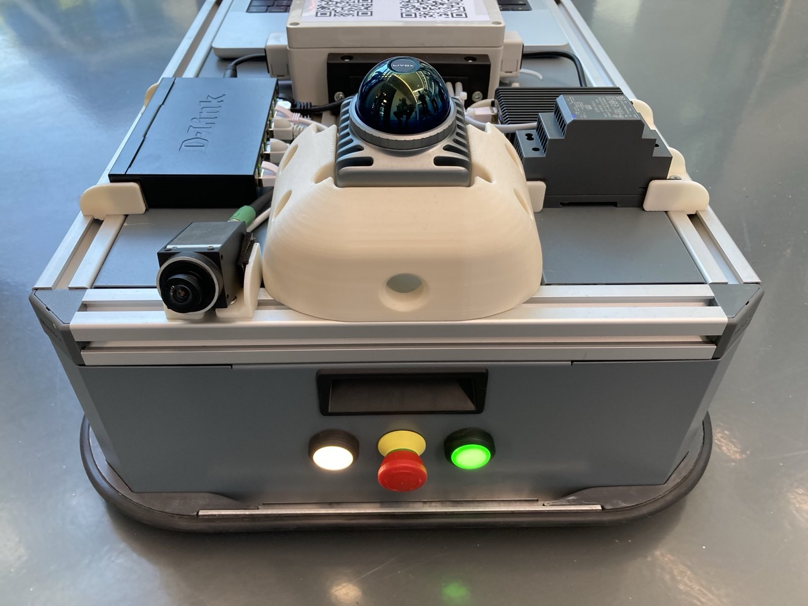

# WALL-E


Control backend for a WALL-E robot: you tell it what to do in plain language (typed or spoken), an LLM turns that into robot actions, and a camera can stop the robot with a hand gesture.

It was built by a team at the Black Forest Hackathon Offenburg 2025 (SEW-EURODRIVE challenge).

## How it works



- **`brain/`** is the backend. `POST /command` sends your text to an LLM that can call robot tools: `move`, `gotopoint`, `sleep`, `halt`, `standby`, `work_mode`, `wait_until`, `save_position`. The system prompt (`brain/src/brain/prompt.py`) tells the model to run one step at a time and to put safety first.
- **The Manager** (`brain/src/brain/manager.py`) runs the tools one after another in a background thread and talks to the robot over REST: it reads the pose and sends goal poses.
- **`gesture/gesture_recognition.py`** watches a camera. On a stop gesture it calls `/stop`; when the person steps away it calls `/resume` and the robot continues to its last target.
- **`whisper_mic.py`** records speech, transcribes it with Whisper and sends it to `/command`.

## Repository layout

| Path | What it is |
| --- | --- |
| `brain/src/brain/` | FastAPI app, routes, LLM connection, tool definitions, manager |
| `brain/run.py` | Starts the backend on port 8000 |
| `gesture/` | Camera and gesture recognition (needs the Baumer NeoAPI camera driver) |
| `whisper_mic.py` | Voice input |
| `.env.example` | Settings template |

## Quick start (backend only)

You need Python 3.10+ and an [OpenRouter](https://openrouter.ai) API key.

```bash
cd brain
python -m venv .venv
source .venv/bin/activate        # Windows: .venv\Scripts\activate
pip install -r requirements.txt
pip install -e .
cp ../.env.example .env          # then put your key into .env
python run.py
```

Open `http://localhost:8000/docs` for the API docs.

### Settings

Set these in `brain/.env` or as environment variables.

| Variable | Default | Meaning |
| --- | --- | --- |
| `OPENAI_API_KEY` | required | Your OpenRouter API key (the name is historical) |
| `OPENAI_MODEL` | `gpt4.1` | Model name on OpenRouter, for example `openai/gpt-4o` |
| `MAX_TOKENS` | `1000` | Max tokens per completion |
| `URL` | `http://192.168.24.82:8081` | Address of the robot's REST API |
| `BRAIN_API_KEY` | not set | If set, the control endpoints need the header `X-API-Key` (see Safety) |
| `MAX_MOVE_METERS` | not set | If set, the LLM `move` tool refuses longer moves (see Safety) |

### Send a command

```bash
curl -X POST http://localhost:8000/command \
  -H 'Content-Type: application/json' \
  -d '{"message": "move two meters forward"}'
```

Other endpoints: `POST /stop` stops the robot immediately, `POST /resume` continues to the last target, `POST /interrupt` is currently unused.

### Run without a robot

`brain/mock_robot.py` is a small fake robot that serves the same two REST endpoints and drives to the goal at 1 m/s.

```bash
cd brain
python mock_robot.py &                       # fake robot on port 8081
URL=http://localhost:8081 python run.py      # backend pointed at it
```

## Voice and gesture

```bash
pip install -r gesture/requirements.txt
pip install -r requirements.txt
python whisper_mic.py                    # speak commands
python gesture/gesture_recognition.py    # stop gesture
```

Both scripts send to `http://localhost:8000` by default. The gesture script needs the camera driver: [Baumer NeoAPI](https://www.baumer.com/de/en/product-overview/industrial-cameras-image-processing/software/baumer-neoapi/c/42528).

Say something like "move two meters forward". If you stop the robot with a gesture it pauses, and it continues when you step out of the way.

## Safety

The backend can move a physical robot, so treat the endpoints like a remote control.

- `/command`, `/stop`, `/resume` and `/interrupt` are open by default and the server listens on all interfaces. Set `BRAIN_API_KEY` to require an `X-API-Key` header. `whisper_mic.py` and the gesture script send it automatically when `BRAIN_API_KEY` is set in their environment. Set `BRAIN_URL` if the backend is not on `localhost:8000`.
- Set `MAX_MOVE_METERS` to cap how far the LLM may move the robot in one `move` call. Named positions (`gotopoint`) are not capped.
- The model is told to put safety first, but the prompt is not a guarantee. Keep the stop gesture or a physical stop within reach.

## Limits

This is a hackathon prototype. It is tied to one robot setup (the REST API behind `URL`) and one camera type, and it has no automated tests. Read the safety notes below before pointing it at a real robot.


